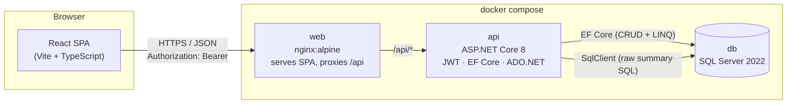
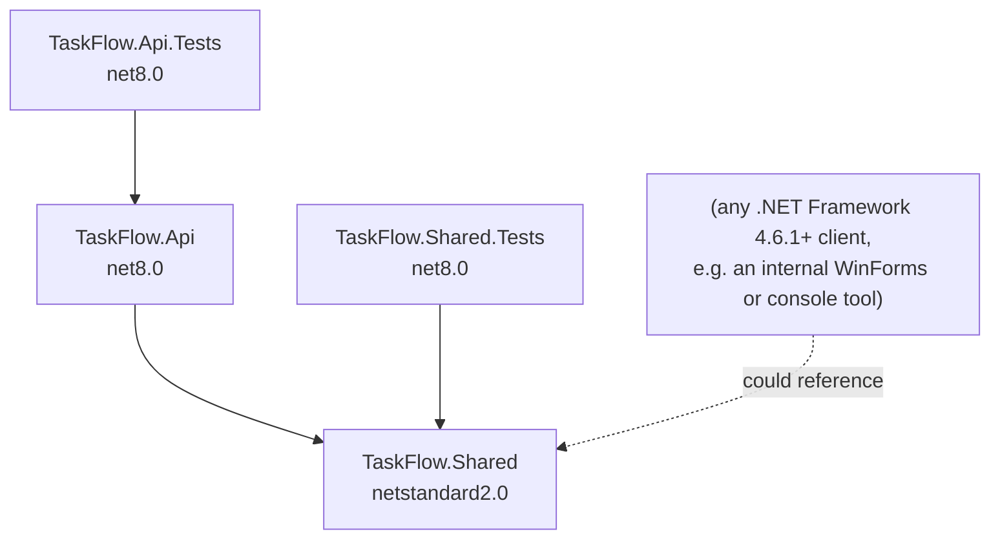
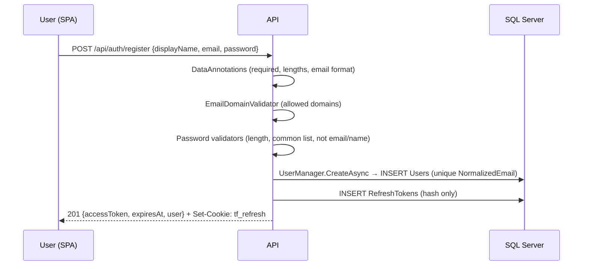
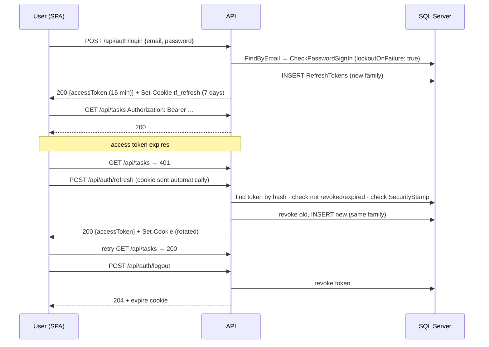

# TaskFlow — Architecture & Implementation Plan

> **Status:** v1.0, implemented · **Created:** 2026-09-28 · **Updated:** 2026-09-30 · **Scope:** internal team task manager
> **v0.2:** added self-service registration, refresh-token sessions and sign-out (§4.2, §5, §6, §7, §9, §13).
> **Companion:** UI mockups in [`docs/mockups/index.html`](mockups/index.html) (desktop / tablet / mobile)
>
> Everything in this document is implemented; §12 records the delivery phases and §13 the approved decisions.
> Where the design changed during implementation or review, this document was updated to match the code.

---

## 1. Goals and non-goals

**Goals**

- A REST API (.NET 8) to list, filter, read, create, update and soft-delete tasks.
- A React single-page app that shows tasks as a table (desktop) or cards (mobile), creates tasks, changes status inline, and colour-codes priority.
- SQL Server as the store, schema managed by EF Core Code First migrations, seeded with sample data.
- A raw-SQL summary endpoint, unit tests, Docker, and a shared .NET Standard library.
- Account registration and sign-in: people create their own account with a work email, sign in, stay signed in across page reloads, and sign out.

**Non-goals (for this iteration)**

- Multi-tenant or per-project task separation.
- Comments, attachments, due dates, notifications, real-time updates.
- Email verification and "forgot password" (both need an email-sending service; see §13).
- Roles and admin screens: every signed-in user can do everything.
- Restoring soft-deleted tasks from the UI (possible later via an admin endpoint).

---

## 2. System overview



In Docker the browser only talks to nginx, so the SPA and API share an origin and no CORS is needed. In local development the Vite dev server proxies `/api` to the API for the same reason; CORS is still configured for `http://localhost:5173` as a fallback.

---

## 3. Solution structure

```
claude-test/
├── TaskFlow.sln
├── Directory.Build.props            # Nullable, LangVersion, TreatWarningsAsErrors
├── docker-compose.yml
├── .env.example                     # SA password, JWT signing key (never committed as .env)
├── database/
│   ├── seed.sql                     # Stand-alone seed script (mirrors the EF seed migration)
│   └── task-summary.sql             # The raw summary query, runnable in SSMS / Azure Data Studio
├── docs/
│   ├── ARCHITECTURE.md              # this file
│   └── mockups/index.html
├── src/
│   ├── TaskFlow.Shared/             # netstandard2.0 — enums, DTO contracts, validation, helpers
│   ├── TaskFlow.Api/                # net8.0 — Web API, EF Core, auth, raw SQL
│   └── TaskFlow.Web/                # React 18 + Vite + TypeScript
└── tests/
    ├── TaskFlow.Api.Tests/          # xUnit — service + handler tests
    └── TaskFlow.Shared.Tests/       # xUnit — helper/validation tests (runs the netstandard lib on net8.0)
```

### Project dependencies



**Why not Clean Architecture with four projects?** The domain is one entity with CRUD rules. Splitting Domain / Application / Infrastructure would add ceremony without isolating anything real. Inside `TaskFlow.Api` the code is still layered by folder (Controllers → Services → Data), services depend on interfaces, and the raw SQL lives behind its own interface, so a later split is a file move, not a rewrite.

### 3.1 `TaskFlow.Shared` (netstandard2.0)

This is the "cross-framework awareness" piece. .NET Standard 2.0 is the highest version that both .NET Framework (4.6.1+) and modern .NET implement, so anything here can be consumed by the API today and by a legacy internal tool tomorrow.

| Item | Purpose |
|---|---|
| `TaskItemStatus` enum | `ToDo = 0, InProgress = 1, Done = 2` |
| `TaskPriority` enum | `Low = 0, Medium = 1, High = 2, Critical = 3` (ordered so sorting by value = sorting by urgency) |
| `CreateTaskRequest`, `UpdateTaskRequest`, `UpdateTaskStatusRequest`, `TaskResponse`, `TaskSummaryResponse` | API contracts, shared so any .NET client can deserialize them |
| `DefinedEnumAttribute` | A `ValidationAttribute` that rejects numeric values that are not declared enum members (`(TaskPriority)99` binds successfully without it) |
| `TaskFieldLimits` | `TitleMaxLength = 200`, `DescriptionMaxLength = 2000`, `AssignedToMaxLength = 100` — used by both DTO validation and EF column config, so they cannot drift |
| `RegisterRequest`, `LoginRequest`, `AuthResponse`, `UserResponse` | Account contracts |
| `AccountRules` | `PasswordMinLength = 12`, `DisplayNameMaxLength = 100`, `EmailMaxLength = 256` — used by the DTOs, Identity options and the EF config |
| `EnumDisplay` | `ToDisplayName()` → `"In Progress"`, and `TryParseFlexible("in progress")` for .NET clients that parse user input (the API itself uses the stricter `StrictEnum`, see §5.3) |

Notes on targeting netstandard2.0:

- Uses `System.ComponentModel.Annotations` (NuGet) for DataAnnotations.
- DTOs are plain classes with `{ get; set; }`; `record` and `init` need `IsExternalInit`, which netstandard2.0 lacks. We avoid polyfills to keep the library honest.
- `<LangVersion>latest</LangVersion>` and `<Nullable>enable</Nullable>` still work for annotations.

> **Naming:** the entity is `TaskItem` and the status enum `TaskItemStatus` to avoid colliding with `System.Threading.Tasks.Task` and `System.Threading.Tasks.TaskStatus`, which are imported everywhere via implicit usings.

### 3.2 `TaskFlow.Api` (net8.0)

```
TaskFlow.Api/
├── Program.cs                       # composition root and middleware order
├── Controllers/
│   ├── AuthController.cs            # register, login, refresh, logout, me
│   ├── UsersController.cs           # GET /api/users (assignee suggestions)
│   ├── TasksController.cs           # CRUD + /summary
│   └── TaskListQuery.cs             # query-string model for GET /api/tasks
├── Domain/                          # TaskItem, AppUser (: IdentityUser<int>), RefreshToken, IHasTimestamps
├── Services/
│   ├── ITaskService.cs / TaskService.cs               # business logic + LINQ
│   ├── ITaskSummaryQuery.cs / SqlTaskSummaryQuery.cs  # raw SQL via SqlClient
│   ├── IAuthService.cs / AuthService.cs               # register / login / refresh / logout rules
│   └── ITokenService.cs / JwtTokenService.cs          # access token (JWT) creation
├── Security/                        # EmailDomainValidator, CommonPasswordValidator,
│                                    # PersonalInfoPasswordValidator, TokenHasher
├── Data/
│   ├── AppDbContext.cs              # IdentityUserContext; query filter, audit timestamps, UTC converter
│   ├── Configurations/              # IEntityTypeConfiguration<T> per entity
│   ├── Seed/TaskSeedData.cs         # HasData rows (deterministic)
│   ├── DatabaseStartup.cs           # migrate on startup + demo users (Development/Docker only)
│   └── Migrations/
├── Errors/
│   ├── GlobalExceptionHandler.cs    # IExceptionHandler → ProblemDetails; the one place exceptions are logged
│   ├── ProblemDetailsSetup.cs       # traceId/errorCode on every problem; model-state 400 shape
│   ├── AppException.cs, AuthExceptions.cs, ErrorCodes.cs
│   └── SqlErrors.cs                 # SQL error number → 409 / 503 / 500
├── Infrastructure/
│   ├── ServiceCollectionExtensions.cs  # DB, Identity, JWT, Swagger registration
│   ├── StrictEnum.cs                # one-name-only enum parsing (JSON converter + model binder)
│   ├── RequestLoggingMiddleware.cs  # one log line per request
│   ├── RateLimits.cs, RefreshCookie.cs, RequireClientHeaderAttribute.cs
│   ├── ForwardedHeadersSetup.cs     # trusted proxies for X-Forwarded-For
│   └── FieldNames.cs, EnumNamesSchemaFilter.cs
├── Options/                         # JwtOptions, AuthOptions, SeedOptions (validated on start)
├── Mapping/TaskMappings.cs          # entity ↔ DTO (hand-written, no AutoMapper)
└── appsettings*.json
```

---

## 4. Data model

### 4.1 `TaskItem` entity

| Column | SQL type | Rules |
|---|---|---|
| `Id` | `int IDENTITY` PK | |
| `Title` | `nvarchar(200)` NOT NULL | required, trimmed, 1–200 chars |
| `Description` | `nvarchar(2000)` NULL | optional |
| `Status` | `tinyint` NOT NULL | `CHECK (Status BETWEEN 0 AND 2)` |
| `Priority` | `tinyint` NOT NULL | `CHECK (Priority BETWEEN 0 AND 3)` |
| `AssignedTo` | `nvarchar(100)` NULL | free text per requirement (display name or email) |
| `CreatedDate` | `datetime2(3)` NOT NULL | UTC, set on insert only |
| `ModifiedDate` | `datetime2(3)` NOT NULL | UTC, set on insert and every update |
| `IsDeleted` | `bit` NOT NULL | |

There are no database default constraints: the API always writes every column (a new task defaults to To Do in `TaskService`). Scripts that insert rows directly must supply all values, as `database/seed.sql` does.

**Why store enums as `tinyint` rather than strings?** Sorting. `ORDER BY Priority DESC` must put *Critical* before *High*; with strings it sorts alphabetically. Integers also keep the index small. The API still exposes enums as strings in JSON (`"InProgress"`), and the raw summary maps codes to names in C#. The check constraints stop bad values arriving by any path, including hand-written SQL.

**Indexes**

- `IX_Tasks_Status_Priority` on `(Status, Priority)` **filtered** `WHERE IsDeleted = 0` — covers both the list filters and the summary `GROUP BY`.
- `IX_Tasks_AssignedTo` filtered `WHERE IsDeleted = 0` — for the assignee filter.

### 4.2 Users and sessions

Accounts use **ASP.NET Core Identity** (`AddIdentityCore<AppUser>()` + EF stores), **without** its cookie UI or `MapIdentityApi`. Identity supplies the parts that are easy to get wrong by hand: salted PBKDF2 hashing with automatic re-hashing when the work factor changes, case-insensitive unique emails (`NormalizedEmail`), lockout counters, password validators and a security stamp. Our own `AuthController` issues JWTs and returns our ProblemDetails error format.

Only the tables we use are mapped: `AspNetUsers` (as `Users`) plus `RefreshTokens`. Role, claim, login and token tables are left out.

**`Users`** (Identity's `IdentityUser<int>` plus one column)

| Column | Type | Notes |
|---|---|---|
| `Id` | `int IDENTITY` PK | |
| `DisplayName` | `nvarchar(100)` NOT NULL | added by us; shown in the header and offered as an assignee |
| `Email` / `NormalizedEmail` | `nvarchar(256)` | unique index on `NormalizedEmail` |
| `UserName` / `NormalizedUserName` | `nvarchar(256)` | set to the email |
| `PasswordHash` | `nvarchar(max)` | Identity v3 format (PBKDF2-HMAC-SHA512, 100k iterations) |
| `SecurityStamp` | `nvarchar(max)` | changes on password change, which invalidates all refresh tokens |
| `AccessFailedCount`, `LockoutEnd`, `LockoutEnabled` | | lockout |
| `CreatedDate` | `datetime2(3)` | added by us |

**`RefreshTokens`**

| Column | Type | Notes |
|---|---|---|
| `Id` | `int IDENTITY` PK | |
| `UserId` | `int` FK → `Users` | cascade delete |
| `TokenHash` | `char(64)` UNIQUE | SHA-256 of the token; the raw token only ever exists in the cookie |
| `FamilyId` | `uniqueidentifier` | all tokens descended from one sign-in |
| `ExpiresAt`, `CreatedAt`, `RevokedAt` | `datetime2(3)` | |
| `ReplacedByTokenHash` | `char(64)` NULL | set when rotated |

Tasks still keep `AssignedTo` as a string (as specified) rather than a foreign key to `Users`. The UI suggests registered users' display names, but free text is still accepted.

### 4.3 Soft delete

- `AppDbContext` applies a global query filter: `modelBuilder.Entity<TaskItem>().HasQueryFilter(t => !t.IsDeleted)`. Every EF query excludes deleted rows without each call site remembering to.
- `DELETE /api/tasks/{id}` sets `IsDeleted = true` and bumps `ModifiedDate`; the row stays.
- Deleting an already-deleted task returns **404** (it is invisible to the filter), which keeps the endpoint idempotent from the caller's view.
- **Query filters do not apply to raw SQL**, so the summary query carries its own `WHERE IsDeleted = 0`. A unit test guards this (see §9).

### 4.4 Audit timestamps

`AppDbContext.SaveChangesAsync` is overridden: for `Added` entries it sets `CreatedDate` and `ModifiedDate`; for `Modified` entries it sets `ModifiedDate` and marks `CreatedDate` as not modified. Time comes from the injected `TimeProvider` (new in .NET 8) so tests can freeze the clock with `FakeTimeProvider`.

### 4.5 Seed data

Seeding is done in an **EF migration** (`20260928_SeedSampleTasks`) using `HasData`, so `dotnet ef database update` alone produces a demo-ready database. `HasData` requires fixed values, so dates are literal UTC timestamps rather than `DateTime.UtcNow`. The same rows are also provided as `database/seed.sql` for anyone who prefers running a script.

13 rows are seeded: 12 visible, plus 1 soft-deleted row (#13) that proves the filter works.

| # | Title | Status | Priority | Assigned to |
|---|---|---|---|---|
| 1 | Set up CI pipeline for API | In Progress | High | Priya Nair |
| 2 | Migrate user reports to new schema | To Do | Critical | Daniel Okafor |
| 3 | Fix date picker timezone offset | In Progress | Critical | Marta Silva |
| 4 | Write onboarding guide for new hires | To Do | Low | Sam Chen |
| 5 | Review Q3 access permissions audit | Done | High | Aisha Rahman |
| 6 | Add rate limiting to public endpoints | To Do | High | Daniel Okafor |
| 7 | Update npm dependencies after audit | Done | Medium | Sam Chen |
| 8 | Design empty states for dashboard | In Progress | Medium | Lena Fischer |
| 9 | Archive legacy SharePoint site | To Do | Low | Aisha Rahman |
| 10 | Investigate slow task list query | In Progress | High | Priya Nair |
| 11 | Prepare sprint demo slides | Done | Low | Lena Fischer |
| 12 | Rotate SQL Server service credentials | To Do | Critical | Marta Silva |
| 13 | ~~Evaluate Trello export~~ | To Do | Low | Sam Chen — **IsDeleted = 1** |

Visible totals: **To Do 5 · In Progress 4 · Done 3**; **Critical 3 · High 4 · Medium 2 · Low 3**.

Demo users are not in the migration because salted hashes are non-deterministic. `DatabaseStartup.PrepareDatabaseAsync` creates them at startup through `UserManager`, only when `Seed:DemoUsers` is enabled (Development and Docker), reading credentials from configuration / `.env`. Anyone can also just register.

---

## 5. API design

Base path `/api`. JSON uses camelCase and string enums (`StrictEnumConverterFactory`: exactly one declared name, see §5.3). Every endpoint requires a bearer token except register, login, refresh, logout and health.

**Account endpoints**

| Method | Route | Purpose | Success | Errors |
|---|---|---|---|---|
| `POST` | `/api/auth/register` | Create an account and sign in | `201` `AuthResponse` + refresh cookie | `400` (validation, weak password), `403` (email domain not allowed), `409` (email already registered), `429` |
| `POST` | `/api/auth/login` | Sign in with email + password | `200` `AuthResponse` + refresh cookie | `400`, `401` (wrong credentials or locked out), `429` |
| `POST` | `/api/auth/refresh` | Swap the refresh cookie for a new access token (rotates the cookie) | `200` `AuthResponse` | `401` |
| `POST` | `/api/auth/logout` | Revoke the refresh token and clear the cookie | `204` | — |
| `GET` | `/api/auth/me` | Current user | `200` `UserResponse` | `401` |
| `GET` | `/api/users` | Display names of registered users, for the assignee suggestions | `200` `UserSummary[]` | `401` |

`AuthResponse` = `{ accessToken, expiresAt, user: { id, email, displayName } }`.

**Task endpoints**

| Method | Route | Purpose | Success | Errors |
|---|---|---|---|---|
| `GET` | `/api/tasks` | List tasks with filters and sorting | `200` `TaskResponse[]` | `400`, `401` |
| `GET` | `/api/tasks/{id:int}` | Get one task | `200` `TaskResponse` | `401`, `404` |
| `POST` | `/api/tasks` | Create | `201` + `Location` header | `400`, `401` |
| `PUT` | `/api/tasks/{id:int}` | Replace editable fields | `200` `TaskResponse` | `400`, `401`, `404` |
| `PATCH` | `/api/tasks/{id:int}/status` | Change status only (the inline dropdown / drag) | `200` `TaskResponse` | `400`, `401`, `404` |
| `DELETE` | `/api/tasks/{id:int}` | Soft delete | `204` | `401`, `404` |
| `GET` | `/api/tasks/summary` | Counts by status × priority (raw SQL) | `200` `TaskSummaryResponse` | `401` |
| `GET` | `/health/live` · `/health/ready` | Process is up · database reachable (Docker healthcheck) | `200` | `503` |

The `{id:int}` route constraint stops `/api/tasks/summary` being captured as an id.

The dedicated `PATCH …/status` endpoint exists because the UI changes status far more often than anything else; it sends one field instead of re-sending the whole task, and avoids overwriting someone else's concurrent title edit.

### 5.1 Query parameters for `GET /api/tasks`

| Param | Example | Notes |
|---|---|---|
| `status` | `?status=ToDo&status=InProgress` | repeatable; any of |
| `priority` | `?priority=High&priority=Critical` | repeatable; any of |
| `assignedTo` | `?assignedTo=Priya` | case-insensitive contains |
| `search` | `?search=schema` | matches title or description |
| `sortBy` | `priority` \| `modified` \| `created` \| `title` \| `status` | default `priority` |
| `sortDir` | `asc` \| `desc` | default `desc` |

Pagination is intentionally omitted: an internal team will have hundreds of tasks, not millions. Adding `page`/`pageSize` later is additive (see §13).

### 5.2 Contracts

```jsonc
// POST /api/tasks  (CreateTaskRequest)
{
  "title": "Rotate SQL Server service credentials",   // required, ≤ 200
  "description": "Quarterly rotation; update Key Vault.", // optional, ≤ 2000
  "status": "ToDo",                                    // optional, default ToDo
  "priority": "Critical",                              // required
  "assignedTo": "Marta Silva"                          // optional, ≤ 100
}

// TaskResponse
{
  "id": 12,
  "title": "Rotate SQL Server service credentials",
  "description": "Quarterly rotation; update Key Vault.",
  "status": "ToDo",
  "priority": "Critical",
  "assignedTo": "Marta Silva",
  "createdDate": "2026-09-21T09:15:00.000Z",
  "modifiedDate": "2026-09-27T16:40:12.345Z"
}

// GET /api/tasks/summary  (TaskSummaryResponse)
{
  "total": 12,
  "byStatus":   { "ToDo": 5, "InProgress": 4, "Done": 3 },
  "byPriority": { "Low": 3, "Medium": 2, "High": 4, "Critical": 3 },
  "matrix": [
    { "status": "ToDo", "priority": "Low", "count": 2 },
    { "status": "ToDo", "priority": "High", "count": 1 }
    // … one entry per non-empty (status, priority) pair
  ]
}
```

### 5.3 Validation

Two layers, one error shape:

1. **Contract validation** (DataAnnotations on the shared DTOs, run automatically by `[ApiController]`):
   - `[Required]`, `[StringLength(TaskFieldLimits.TitleMaxLength)]` on `Title`, plus a custom `[NotWhiteSpace]`.
   - `[DefinedEnum]` on `Status` and `Priority`.
   - Unknown enum *strings* (`"Urgent"`) fail JSON deserialization; that too is turned into a 400 with a field-level message rather than a generic parse error.
   - Enum values are accepted **only as one declared name**, case-insensitive (`StrictEnum`), in JSON bodies and in query strings. Numbers (`3`, `"2"`) and comma-separated lists (`"Medium, High"`, `?status=ToDo,InProgress`) are rejected with 400: the framework defaults would OR them together as `[Flags]` and silently store a different value. To filter by several values, repeat the parameter.
2. **Business rules** in `TaskService` throw `DomainValidationException` (e.g. title trimmed to empty). The exception handler maps it to the same 400 shape.

`ApiBehaviorOptions.InvalidModelStateResponseFactory` is replaced so model-state failures produce exactly the same body as the exception handler.

### 5.4 Global exception handler and error format

Implemented with .NET 8's `IExceptionHandler` + `AddProblemDetails()`, returning RFC 7807 `application/problem+json` for every failure:

```json
{
  "type": "https://tools.ietf.org/html/rfc9110#section-15.5.1",
  "title": "Validation failed",
  "status": 400,
  "detail": "One or more fields are invalid.",
  "instance": "/api/tasks",
  "errorCode": "VALIDATION_FAILED",
  "traceId": "00-4bf92f3577b34da6a3ce929d0e0e4736-00f067aa0ba902b7-01",
  "errors": { "title": ["Title is required."] }
}
```

| Exception | Status | `errorCode` |
|---|---|---|
| `DomainValidationException` / invalid model state | 400 | `VALIDATION_FAILED` |
| `NotFoundException` | 404 | `TASK_NOT_FOUND` |
| Identity password / user validation failures on register | 400 | `VALIDATION_FAILED` (Identity error codes mapped onto `email` / `password` fields) |
| `EmailDomainNotAllowedException` | 403 | `EMAIL_DOMAIN_NOT_ALLOWED` |
| `EmailAlreadyRegisteredException` | 409 | `EMAIL_TAKEN` |
| `InvalidCredentialsException` | 401 | `INVALID_CREDENTIALS` (also while locked out) |
| `AccountNotFoundException` (valid token, user no longer exists) | 401 | `UNAUTHENTICATED` |
| `DbUpdateConcurrencyException` | 409 | `CONCURRENCY_CONFLICT` |
| `DbUpdateException` from a unique index (SQL 2601/2627) | 409 | `DUPLICATE_VALUE` |
| `DbUpdateException` from a CHECK/FOREIGN KEY constraint (SQL 547) | 409 | `CONSTRAINT_VIOLATION` |
| Transient SQL errors (server unreachable or refusing connections, timeouts, deadlocks, any severity ≥ 20) or EF retries exhausted | 503 | `DATABASE_UNAVAILABLE` |
| anything else | 500 | `UNEXPECTED_ERROR` — `detail` is generic outside Development; full exception is logged with the `traceId` |
| *nginx:* request body over 1 MB | 413 | `PAYLOAD_TOO_LARGE` |
| *nginx:* API unreachable or timing out (502/503/504 from the proxy) | 503 + `Retry-After` | `API_UNAVAILABLE` |

401/403 from the auth middleware are also shaped as ProblemDetails via `UseStatusCodePages` so the front end parses one format.

### 5.5 The LINQ query (filtering + sorting)

`TaskService.GetTasksAsync` builds an `IQueryable` step by step; EF translates the whole chain to one SQL statement.

```csharp
public async Task<IReadOnlyList<TaskResponse>> GetTasksAsync(TaskQuery q, CancellationToken ct)
{
    IQueryable<TaskItem> tasks = _db.Tasks.AsNoTracking();   // IsDeleted filter applied globally

    if (q.Statuses is { Count: > 0 })
        tasks = tasks.Where(t => q.Statuses.Contains(t.Status));

    if (q.Priorities is { Count: > 0 })
        tasks = tasks.Where(t => q.Priorities.Contains(t.Priority));

    if (!string.IsNullOrWhiteSpace(q.AssignedTo))
        tasks = tasks.Where(t => t.AssignedTo != null && t.AssignedTo.Contains(q.AssignedTo));

    if (!string.IsNullOrWhiteSpace(q.Search))
        tasks = tasks.Where(t => t.Title.Contains(q.Search)
                              || (t.Description != null && t.Description.Contains(q.Search)));

    tasks = (q.SortBy, q.SortDir) switch
    {
        (TaskSortField.Priority, SortDirection.Desc) =>
            tasks.OrderByDescending(t => t.Priority).ThenByDescending(t => t.ModifiedDate),
        (TaskSortField.Priority, SortDirection.Asc) =>
            tasks.OrderBy(t => t.Priority).ThenByDescending(t => t.ModifiedDate),
        (TaskSortField.Modified, SortDirection.Desc) => tasks.OrderByDescending(t => t.ModifiedDate),
        (TaskSortField.Modified, SortDirection.Asc)  => tasks.OrderBy(t => t.ModifiedDate),
        (TaskSortField.Title, SortDirection.Desc)    => tasks.OrderByDescending(t => t.Title),
        (TaskSortField.Title, _)                     => tasks.OrderBy(t => t.Title),
        // … status, created
        _ => tasks.OrderByDescending(t => t.Priority).ThenByDescending(t => t.ModifiedDate)
    };

    return await tasks.Select(TaskMappings.ToResponse).ToListAsync(ct);   // projection → no over-fetch
}
```

Points worth noting: `Contains` on a list becomes `IN (…)`, the projection runs in SQL so only needed columns are read, SQL Server's default collation makes `Contains` case-insensitive, and the tie-breaker `ThenByDescending(ModifiedDate)` keeps order stable.

### 5.6 The raw SQL summary (not EF)

`SqlTaskSummaryQuery` uses `Microsoft.Data.SqlClient` directly (`SqlConnection` → `SqlCommand` → `SqlDataReader`) with the same connection string as EF. This keeps it genuinely outside EF, as the requirement asks.

```sql
-- database/task-summary.sql
SELECT
    t.Status,
    t.Priority,
    COUNT(*)                     AS TaskCount,
    GROUPING(t.Status)           AS IsStatusRollup,
    GROUPING(t.Priority)         AS IsPriorityRollup
FROM dbo.Tasks AS t
WHERE t.IsDeleted = 0
GROUP BY GROUPING SETS (
    (t.Status, t.Priority),   -- the status × priority matrix
    (t.Status),               -- totals per status
    (t.Priority),             -- totals per priority
    ()                        -- grand total
)
ORDER BY IsStatusRollup, IsPriorityRollup, t.Status, t.Priority;
```

One round trip returns the matrix, both sets of totals and the grand total. The `GROUPING()` flags tell the reader which row type it is; C# maps `tinyint` codes to enum names and fills zero counts so the UI always receives every status and priority key.

---

## 6. Authentication

**Approach:** ASP.NET Core Identity for accounts (§4.2). The API issues **short-lived JWT access tokens** plus a **rotating refresh token in an httpOnly cookie**.

### 6.1 Registration



Rules:

| Rule | Value | Where |
|---|---|---|
| Display name | required, 2–100 chars | DTO in `TaskFlow.Shared` |
| Email | required, valid format, ≤ 256, unique (case-insensitive) | DTO + Identity `RequireUniqueEmail` |
| Allowed email domains | `Auth:AllowedEmailDomains`, e.g. `["company.com"]`; empty list = anyone (development only) | `EmailDomainValidator` |
| Password | ≥ 12 characters; no forced symbols or digits (NIST SP 800-63B); rejected if it is a well-known long password, a keyboard/alphabet run, a short unit repeated ("abcabcabcabc"), has fewer than 4 distinct characters, or contains the email's local part or the display name | Identity `PasswordOptions` + `CommonPasswordValidator` + `PersonalInfoPasswordValidator` |
| Rate limit | 5 registrations / 10 min / IP | ASP.NET Core rate limiter |

A successful registration signs the user in immediately, so there's no second step.

**Why register returns `409 EMAIL_TAKEN`:** it tells a caller that an email has an account. That's an accepted trade-off for an internal tool limited to company domains; the alternative ("check your inbox") needs email sending, which is out of scope. The rate limit caps how fast anyone can probe.

### 6.2 Sign-in, session and sign-out



| Aspect | Decision |
|---|---|
| **Access token** | JWT, HMAC-SHA256, **15 minutes**. Claims: `sub` (user id), `email`, `name`, `jti`. Validated for signature, issuer, audience, lifetime (1-minute clock skew). Key from `Jwt__SigningKey` (≥ 32 bytes), never committed. |
| **Where the SPA keeps it** | In memory only (a React ref), never in `localStorage`/`sessionStorage`, so injected script can't read a stored copy. |
| **Refresh token** | 32 random bytes, base64url, **7-day** sliding lifetime. Sent as cookie `tf_refresh`: `HttpOnly; Secure; SameSite=Strict; Path=/api/auth`. `Secure` is controlled by `Auth:CookieSecure` (default true); the local Docker setup turns it off because Safari rejects Secure cookies on `http://localhost`. Keep it on anywhere served over HTTPS. A failed refresh also deletes the cookie. Only its SHA-256 hash is stored. |
| **Rotation + reuse detection** | Each refresh revokes the used token and issues a new one in the same family. If an already-revoked token is presented (it has been stolen and replayed), the whole family is revoked and the user must sign in again. |
| **Page reload** | The in-memory access token is lost; on start-up the SPA calls `POST /api/auth/refresh` once. The cookie restores the session, or the user sees the sign-in page. |
| **CSRF** | The cookie is `SameSite=Strict` and scoped to `/api/auth`. `/refresh` and `/logout` also require an `X-TaskFlow-Client` header (its presence is checked; the SPA sends `web`), which a cross-site form can't send. Task endpoints use the bearer header, not cookies, so they aren't exposed to CSRF. |
| **Lockout** | 5 failed passwords → locked for 15 minutes (Identity lockout). While locked, login returns the *same* `401 INVALID_CREDENTIALS` as any other failure (no unlock time, no separate code) and still runs a hash check, so a caller can't tell a locked account from a wrong password or unknown email. Trade-off: anyone who knows a colleague's email can lock them out for 15 minutes; the per-IP login rate limit slows this, and per-account throttling or CAPTCHA would be the next step if it becomes a problem. |
| **Wrong credentials** | One response for every failure: `401 INVALID_CREDENTIALS`, "Email or password is incorrect. After several failed attempts, sign-in is paused for 15 minutes." There's no attempts-left count (it would reveal that the account exists). Unknown emails and locked accounts still run a hash comparison, so response times don't reveal which case it was. |
| **Rate limits** | Login 10 / min / IP; register 5 / 10 min / IP; refresh 30 / min / IP. Exceeding them returns `429` with `Retry-After`. |
| **Trusted proxies** | Rate limits partition by client IP, so `X-Forwarded-For` is honoured only from configured proxies (`ForwardedHeaders:KnownProxies` / `KnownNetworks`, plus loopback) and only the last hop counts (`ForwardLimit = 1`). In Docker, nginx has a fixed address (`172.30.89.10`) and is the only trusted proxy; any other caller's header is ignored. |
| **Sign out** | Revokes the current refresh token and expires the cookie. Access tokens are not tracked, so an already-issued one stays valid for at most 15 minutes. That's why its lifetime is short. |
| **Password change** | Not in the UI for v1. When it's added, it updates `SecurityStamp`, which invalidates every refresh token for that user. |
| **Same origin** | nginx (Docker) and the Vite proxy (dev) serve SPA and API from one origin, so the `Strict` cookie is always sent and CORS never needs `AllowCredentials`. |
| **Default-deny** | A fallback authorization policy requires an authenticated user everywhere; only the anonymous auth endpoints and `/health/*` opt out. |
| **Swagger** | Bearer security scheme so tokens can be pasted in. |

### 6.3 Production path

The task API depends only on `AddAuthentication().AddJwtBearer(...)`. Moving the team to Microsoft Entra ID later means pointing JWT bearer at the tenant (authority + audience) and using MSAL in the SPA. The register/login/refresh endpoints and the Identity tables would then be removed; nothing in `TasksController` changes.

## 7. Front end (React)

### 7.1 Stack

| Concern | Choice | Why |
|---|---|---|
| Build | **Vite** + **TypeScript** | fast dev server, `/api` proxy, typed contracts |
| Server state | **TanStack Query** | caching, refetch on focus, and optimistic status updates with rollback |
| Forms | controlled components + a small `validateTask()` mirroring the API rules | no form library needed for 5 fields |
| Styling | **CSS Modules** + CSS custom properties (design tokens) | no framework, scoped styles, one token file |
| Routing | **React Router** | `/login`, `/register`, `/` (tasks); protected-route wrapper returns to the original URL after sign-in |
| Dialogs, drawers, sheets, dropdowns | **Radix UI primitives** (`@radix-ui/react-dialog`, `@radix-ui/react-select`), unstyled | focus trap, `Esc`, scroll lock, portals, collision-aware positioning, keyboard + typeahead and correct ARIA, all styled by us, so no CSS framework |
| Drag & drop (board view) | **@dnd-kit/core** | accessible (keyboard drag) and works with touch, unlike native HTML5 DnD |
| Icons | inline SVG components | no icon font |
| Tests | Vitest + React Testing Library | optional, beyond the brief |

No global state library: server state lives in TanStack Query, auth in a small React context, and view preferences (list/board, filters) in the URL query string so views are shareable and survive refresh.

### 7.2 Component tree

```
<App>
 ├─ <AuthProvider>                     access token (in memory) + user; register(), login(), logout()
 │   │                                 calls /auth/refresh once on start-up to restore the session
 │   ├─ <LoginPage>        /login      email, password; shows the API's single failure message
 │   ├─ <RegisterPage>     /register   display name, email, password with live rule checklist
 │   └─ <RequireAuth> → <TasksPage>  /
 │       ├─ <AppHeader>                logo · search · view toggle · New task · <UserMenu> (name, email, Sign out)
 │       ├─ <SummaryStrip>             counts from GET /summary (click = filter)
 │       ├─ <FilterBar>                status + priority chips, assignee, sort
 │       │   └─ <FilterSheet>          mobile bottom-sheet version
 │       ├─ <TaskTable>                ≥ 768 px
 │       │   └─ <TaskRow>              <StatusSelect> <PriorityBadge> <Assignee>
 │       ├─ <TaskCardList>             < 768 px
 │       │   └─ <TaskCard>
 │       ├─ <TaskBoard>                optional board view, drag between columns
 │       ├─ <TaskFormDialog>           create / edit (modal ≥ 768, full-screen sheet < 768)
 │       ├─ <TaskDetailDrawer>         view + edit + delete
 │       ├─ <ConfirmDialog>            soft-delete confirmation
 │       └─ <Toaster>                  success / error toasts
```

### 7.3 API layer

- `api/client.ts` — a thin `fetch` wrapper: adds the bearer header, parses `application/problem+json` into a typed `ApiError { status, errorCode, errors }`. On a 401 it calls `/auth/refresh` **once** (concurrent 401s share one refresh promise), retries the original request, and only if the refresh fails clears the session and sends the user to `/login?returnTo=…`.
- `api/auth.ts` — `register`, `login`, `refresh`, `logout`, `me`. All send `credentials: 'same-origin'`; refresh and logout add the `X-TaskFlow-Client: web` header.
- The register form checks the same rules as the API while typing (length, name/email not in password, passwords match). The common-password check is server-only, and its 400 is shown under the password field.
- `api/tasks.ts` — one function per endpoint; hooks `useTasks(filters)`, `useTask(id)`, `useCreateTask()`, `useUpdateTask()`, `useUpdateStatus()`, `useDeleteTask()`, `useSummary()`.
- **Status change is optimistic**: the pill changes instantly; on error it rolls back and shows a toast. On success the list and summary queries are invalidated.
- Field errors from a 400 map straight onto the form (`errors.title[0]` under the Title input).

### 7.4 Visual language

| Token | Value | Use |
|---|---|---|
| Priority **Critical** | red `#C8303B` + 4 bars + red row edge | |
| Priority **High** | orange `#C2570F` + 3 bars | |
| Priority **Medium** | amber `#8F6A06` + 2 bars | |
| Priority **Low** | slate `#56667B` + 1 bar | |
| Status **To Do** | grey pill, dashed-circle icon | |
| Status **In Progress** | blue pill, half-filled circle icon | |
| Status **Done** | green pill, check icon | |

Priority is never colour-only: the signal-bar icon and text label carry the same meaning for colour-blind users. Status uses pill shape + icon so it cannot be confused with priority.

### 7.5 Responsive behaviour

| Breakpoint | Layout |
|---|---|
| **≥ 1024 px** (desktop) | Full table: ID, title + description preview, status dropdown, priority, assignee, modified, row menu. Filters inline. Edit opens a right-hand drawer; create opens a centred modal. |
| **768–1023 px** (tablet) | Table without ID and Modified columns; description preview hidden. Filters collapse into a "Filters" button + search. Drawer becomes a wider overlay. |
| **< 768 px** (mobile) | Card list with a priority stripe; status select on each card (44 px touch target). Summary strip scrolls horizontally. Filters in a bottom sheet. "New task" becomes a floating action button; the form is a full-screen sheet with sticky actions. Board view becomes one column at a time with a segmented control; drag is replaced by the status select. |

### 7.6 Dropdowns and overlays

**One `<Select>` component** is used for every dropdown: the status pill, the Status field in forms, and the assignee and sort filters. Native `<select>` is not used, because its open list is drawn by the operating system and can't match the design.

- **≥ 768 px:** a popover rendered in a portal (so table and dialog `overflow` can't clip it), aligned to the trigger. It flips upwards when there isn't room below, closes on outside click or `Esc`, and locks page scroll while open (Radix Select's behaviour). Options show their icon (status icon or avatar) and a check next to the current value.
- **< 768 px:** the same options render in a bottom sheet with 48 px rows and a title.
- **Keyboard:** `↓`/`↑` opens and moves, `Enter` selects, `Esc` closes and returns focus to the trigger, and typing a letter jumps to a match. Exposed as a `listbox` with `aria-selected`; the trigger's accessible name includes the current value ("Status for task #6: To Do").

**Overlay rules** (modal, drawer, bottom sheet, confirm dialog, and the mobile dropdown sheet):

1. **The page behind is scroll-locked** while any overlay is open, including iOS Safari (Radix uses `react-remove-scroll`). The scrollbar gap is compensated (`scrollbar-gutter: stable`), so content doesn't shift sideways.
2. **Only the overlay's own body scrolls, and only when its content is taller than the screen.** Scrolling inside an overlay never chains to the page behind (`overscroll-behavior: contain`).
3. **Full-screen forms on phones** are a flex column: a fixed header, a body that fills the remaining space (`flex: 1`), and a footer pinned to the bottom. The Add task form fits on a 390 × 844 screen without scrolling.
4. **No horizontal page scroll at any width.** Layout grids use `minmax(0, 1fr)` tracks so a wide child (such as the scrolling summary strip) can't widen the page. Only the summary strip scrolls sideways, inside its own container.
5. Focus moves into the overlay when it opens and back to the element that opened it when it closes.

Accessibility: semantic `<table>` on desktop, `<ul>` of `<article>` cards on mobile, dialogs with focus trap and `Esc`, visible focus rings, `prefers-reduced-motion` respected, all colour pairs ≥ 4.5 : 1.

See [`docs/mockups/index.html`](mockups/index.html) for every screen at all three widths.

---

## 8. Configuration

| Key | Where | Example / default |
|---|---|---|
| `ConnectionStrings__TaskFlow` | env / user-secrets | `Server=db,1433;Database=TaskFlow;User Id=sa;Password=…;TrustServerCertificate=True;Encrypt=True` |
| `Jwt__Issuer`, `Jwt__Audience` | appsettings | `taskflow-api`, `taskflow-web` |
| `Jwt__SigningKey` | env / user-secrets only | 32+ characters (`openssl rand -base64 48`); validated on start |
| `Jwt__AccessTokenMinutes` | appsettings | `15` |
| `Auth__RefreshTokenDays` | appsettings | `7` |
| `Auth__AllowedEmailDomains__0…` | appsettings / env | `company.com` (empty = any domain; Development only) |
| `Auth__CookieSecure` | appsettings / env | `true`; `false` in Development and the local Docker `.env` |
| `Auth__Lockout__MaxFailedAttempts`, `Auth__Lockout__Minutes` | appsettings | `5`, `15` (the failure message uses the configured minutes) |
| `RateLimits__LoginPerMinute`, `__RegisterPerTenMinutes`, `__RefreshPerMinute` | appsettings | `10`, `5`, `30` per client IP |
| `ForwardedHeaders__KnownProxies__0…`, `ForwardedHeaders__KnownNetworks__0…` | env | Docker: `172.30.89.10` (nginx). Unset = loopback only |
| `Database__MigrateOnStartup` | env | `true` in Development and Docker, `false` otherwise |
| `Seed__DemoUsers`, `Seed__Users__N__Email/DisplayName/Password` | env / appsettings.Development | Development and Docker only |
| `Swagger__Enabled` | appsettings | `true` in Development only (Docker sets `false`) |
| `Cors__AllowedOrigins__0…` | appsettings.Development | `http://localhost:5173` (fallback; the Vite proxy normally makes calls same-origin) |
| `Logging__Console__FormatterName` | env | `json` in Docker |

The web app has no build-time configuration: it always calls `/api` on its own origin (nginx or the Vite proxy).

---

## 9. Testing strategy

| Layer | Where | What it proves |
|---|---|---|
| **Service unit tests** | `tests/TaskFlow.Api.Tests/Services` | `TaskService` and `AuthService` on **in-memory SQLite** (relational, so query filters, `IN`, ordering and unique indexes behave like SQL Server), with the 13 seed rows and a frozen `FakeTimeProvider`: filtering, every sort order, create/update/PUT/PATCH audit dates, soft delete, register rules, lockout, identical sign-in failures, refresh rotation, reuse detection and the grace boundary, expiry, security-stamp invalidation |
| **HTTP pipeline tests** | `tests/TaskFlow.Api.Tests/Api` | The real `Program` via `WebApplicationFactory`: ProblemDetails shape and status codes, strict enum parsing in query and body, malformed JSON, auth cookie flags and deletion, JWT tampering (bad key, `alg:none`, wrong issuer/audience, expired, edited payload), rate limiting with `Retry-After`, `/api/users`, request logging fields and redaction, no Error logs for expected 4xx, trusted-proxy handling |
| **Handler / helper unit tests** | `tests/TaskFlow.Api.Tests/Errors`, `Api` | Exception → status/code mapping and log levels, SQL error classification, enum converter and binder scope |
| **SQL Server integration** | `tests/TaskFlow.Api.Tests/Integration` (`Category=Integration`) | Testcontainers SQL Server 2022 with the real migrations: the raw `GROUPING SETS` summary, the summary over HTTP matching the list after changes, a real unique-key violation mapped to 409. Skipped locally without Docker; fails in CI |
| **Shared library** | `tests/TaskFlow.Shared.Tests` | Validation attributes and messages, `EnumDisplay` round-trips (netstandard2.0 code on .NET 8) |
| **Front end** | `src/TaskFlow.Web/src/test` (Vitest + Testing Library) | API client refresh-and-retry and error parsing; session restore on start-up; login/register behaviour; optimistic status change and targeted rollback; URL filter parsing and limits; form validation mirrors the API |
| **End-to-end smoke** | `.github/scripts/smoke-test.sh` | Against the running Docker stack: auth, list, summary consistency, create (Location header) / patch / soft delete, security headers, Host-less HTTP/1.0 request |

Assertions use xUnit `Assert` (FluentAssertions v8 is commercially licensed). Coverage (coverlet, migrations excluded) is gated at 80% of lines in CI.

Run: `dotnet test --filter "Category!=Integration"` · `dotnet test --filter Category=Integration` · `npm --prefix src/TaskFlow.Web test`.

---

## 10. Docker

`docker-compose.yml` runs three services on a fixed bridge network (`172.30.89.0/24`):

| Service | Image | Notes |
|---|---|---|
| `db` | `mcr.microsoft.com/mssql/server:2022-latest` (`linux/amd64`) | Data in the `mssql-data` volume; health check with `sqlcmd`; published on `127.0.0.1:1433` only, for local tools and `dotnet run` |
| `api` | built from `src/TaskFlow.Api/Dockerfile` | Starts after `db` is healthy; applies migrations and creates demo users; health check on `/health/ready`; JSON console logs; trusts `X-Forwarded-For` only from nginx |
| `web` | built from `src/TaskFlow.Web/Dockerfile` | Unprivileged nginx (uid 101) listening on 8080, with a fixed address `172.30.89.10`; the only service published on all interfaces (`8080:8080`); health check on `/`; starts after `api` is healthy |

- **API image:** multi-stage. `mcr.microsoft.com/dotnet/sdk:8.0` restores with `--locked-mode` (NuGet lock files) and publishes; `mcr.microsoft.com/dotnet/aspnet:8.0` runs it as the built-in non-root `app` user on port 8080. The build context is the repository root so `TaskFlow.Shared` is included.
- **Web image:** `node:22-alpine` runs `npm ci && npm run build`; `nginxinc/nginx-unprivileged:1.27-alpine` (non-root, port 8080) serves `dist/` with SPA fallback, long-lived caching for hashed assets, security headers (CSP, X-Frame-Options, nosniff, Referrer-Policy, Permissions-Policy), and proxies `/api/` to `http://api:8080`, forwarding the client's `Host` with its port (falling back to `localhost` when a client sends none). `/health/` is proxied to the API too. Errors nginx generates itself (413, and 502/503/504 when the API can't be reached within a 5 s connect timeout) are returned as ProblemDetails JSON with an `errorCode` and nginx's request id as `traceId`; the API's own error responses pass through unchanged.
- **Migrations:** applied on API startup when `Database__MigrateOnStartup=true`, with a short retry loop. For real deployments, an EF migration bundle run as a pipeline step is preferred.
- **Fixed subnet:** the pinned nginx address is what lets the API trust exactly one proxy. If `172.30.89.0/24` clashes with a local network or VPN, change the subnet, the `web` address and `ForwardedHeaders__KnownProxies__0` together. A stack created before this network existed needs one `docker compose down` (without `-v`, so data is kept) before `up`.

> **Apple Silicon / macOS note:** SQL Server LocalDB is Windows-only, so on a Mac we use Docker. The SQL Server 2022 image is amd64-only; it runs on Apple Silicon through Rosetta emulation (Docker Desktop: Settings → General → "Use Rosetta for x86/amd64 emulation"; Colima: `colima start --vm-type vz --vz-rosetta`), which is why `platform: linux/amd64` is pinned.

Usage: `cp .env.example .env` → set `JWT_SIGNING_KEY` → `docker compose up --build` → open `http://localhost:8080`.

---

## 11. Cross-cutting concerns

- **Logging:** built-in `ILogger`; JSON console output in Docker. `RequestLoggingMiddleware` (outermost) writes one line per request (method, path, status, elapsed ms, traceId) and never logs query strings, headers or bodies; health probes log at Debug and 5xx at Warning. `GlobalExceptionHandler` is the single place exceptions are logged (unexpected at Error with the stack trace, expected 4xx at Debug); ASP.NET's own exception-handler log category is filtered out to avoid Error-level noise for normal 4xx, and anything that escapes the handler is logged at Error by the request-logging middleware. The logged `traceId` is the one returned in ProblemDetails.
- **Health:** `/health/live` (no dependencies) and `/health/ready` (`AddDbContextCheck<AppDbContext>()`); compose uses `/health/ready`.
- **OpenAPI:** Swashbuckle in Development (`/swagger`), with XML comments, a bearer security scheme and enums documented as names. Disabled in Docker.
- **Cancellation:** every async endpoint accepts `CancellationToken` and passes it to EF / SqlClient.
- **Database errors:** SQL error numbers are classified: unique-key violations → 409 `DUPLICATE_VALUE`, constraint violations → 409 `CONSTRAINT_VIOLATION`, transient/connectivity errors and exhausted EF retries → 503, anything else → 500.
- **Concurrency (considered, deferred):** a `rowversion` column + `If-Match` would stop two people overwriting each other's edits. Last-write-wins is acceptable for a small internal team; the exception handler already maps `DbUpdateConcurrencyException` to 409.
- **CI** (`.github/workflows/ci.yml`): .NET build with warnings as errors, unit + pipeline tests with an 80% line-coverage gate, a migration-drift check, NuGet and npm vulnerability scans, web type-check/lint/test/build, the SQL Server integration tests, and a Docker Compose build with the smoke test.

---

## 12. Implementation plan (delivered)

Each phase ended in a runnable state and was committed separately. All ten phases are complete; after them came project configuration (`CLAUDE.md`), ESLint, coverage, NuGet lock files, CI, request logging, and two rounds of independent review whose findings were fixed test-first.

| Phase | Deliverable | Key tasks |
|---|---|---|
| **1. Skeleton** | Solution builds | Create sln, `Directory.Build.props`, 3 projects + 2 test projects; add NuGet refs; `.gitignore`, `.editorconfig`. |
| **2. Shared library** | `TaskFlow.Shared` + tests | Enums, `TaskFieldLimits`, DTOs, `DefinedEnumAttribute`, `NotWhiteSpaceAttribute`, `EnumDisplay`. |
| **3. Data layer** | DB created from migrations | `TaskItem`, `AppUser`, `RefreshToken`, `IdentityDbContext` mapping (Users + RefreshTokens only), configurations (check constraints, filtered indexes), `AppDbContext` (query filter, audit), `InitialCreate` + `SeedSampleTasks` migrations, `database/seed.sql`. |
| **4. Task API** | CRUD works in Swagger | `TaskService` (LINQ), `TasksController`, mappings, validation, `GlobalExceptionHandler`, ProblemDetails for model state. |
| **5. Summary** | `/api/tasks/summary` | `SqlTaskSummaryQuery` with SqlClient + `GROUPING SETS`; `database/task-summary.sql`. |
| **6. Accounts & auth** | Register, sign in, refresh, sign out work in Swagger; task endpoints locked down | `AddIdentityCore` + options (password, lockout, unique email), `EmailDomainValidator`, `CommonPasswordValidator`, `PersonalInfoPasswordValidator`, `AuthService` (register / login / refresh rotation + reuse detection / logout), `JwtTokenService`, refresh cookie, `AuthController`, `UsersController`, demo-user seeding (`DatabaseStartup`), fallback policy, rate limits, Swagger bearer. |
| **7. Unit tests** | `dotnet test` green | SQLite fixture, `FakeTimeProvider`, the tests in §9; optional Testcontainers integration test. |
| **8. React app** | UI matches mockups | Vite scaffold, tokens, router, API client with refresh-and-retry, auth context, sign-in and create-account pages, user menu with sign out, table + cards, filters, summary, create/edit dialog, status select (optimistic), delete confirm, toasts; board view with dnd-kit. |
| **9. Docker** | `docker compose up` works end to end | API + web Dockerfiles, nginx config, compose, `.env.example`, health checks. |
| **10. Docs** | README | Prerequisites, run locally, run in Docker, demo credentials location, API examples, test commands. |

### Key packages

| Project | Packages |
|---|---|
| Shared | `System.ComponentModel.Annotations` |
| Api | `Microsoft.EntityFrameworkCore.SqlServer` 8.x, `Microsoft.EntityFrameworkCore.Design` 8.x, `Microsoft.Data.SqlClient`, `Microsoft.AspNetCore.Authentication.JwtBearer` 8.x, `Microsoft.AspNetCore.Identity.EntityFrameworkCore` 8.x, `Swashbuckle.AspNetCore`, `Microsoft.Extensions.Diagnostics.HealthChecks.EntityFrameworkCore` |
| Api.Tests | `xunit`, `xunit.runner.visualstudio`, `Microsoft.NET.Test.Sdk`, `Microsoft.EntityFrameworkCore.Sqlite` 8.x, `Microsoft.Extensions.TimeProvider.Testing`, `Testcontainers.MsSql` (optional) |
| Web | `react`, `react-dom`, `react-router`, `@tanstack/react-query`, `@radix-ui/react-dialog`, `@radix-ui/react-select`, `@dnd-kit/core`, `vite`, `typescript`, `vitest`, `@testing-library/react` |

Assertions use xUnit's built-in `Assert` (FluentAssertions v8 moved to a commercial licence, so it is avoided).

---

## 13. Decisions (approved)

| # | Decision | Recommendation | Alternative |
|---|---|---|---|
| 1 | Project layout | Single API project layered by folder + shared lib | Full Clean Architecture (Domain / Application / Infrastructure) |
| 2 | Enum storage | `tinyint` + check constraints (correct sorting) | `nvarchar` strings (readable raw SQL, needs CASE for sorting) |
| 3 | Authentication | ASP.NET Core Identity + self-issued JWT (15 min) + rotating refresh cookie (7 days) | Access token only, re-login every hour (simpler, worse UX) · Microsoft Entra ID (needs a tenant + app registration) |
| 3a | Who can register | Only emails on `Auth:AllowedEmailDomains` (e.g. `company.com`) | Open registration · invite codes issued by an admin |
| 3b | Email verification / password reset | Out of scope for v1 (no email service) | Add now with an SMTP / SendGrid sender and Identity's token providers |
| 4 | Status interaction | Dropdown everywhere **plus** a drag-and-drop board view | Dropdown only (smaller scope) |
| 5 | Front-end data layer | TanStack Query | Plain `fetch` + `useEffect` hooks |
| 6 | Pagination | Not in v1 | Add `page`/`pageSize` now |
| 7 | Concurrency control | Last write wins in v1 | `rowversion` + `If-Match` now |
| 8 | Raw SQL access | ADO.NET `SqlClient` (strictly "not EF") | `Database.SqlQuery<T>` (still raw SQL, but via EF) |

All recommendations above were approved and implemented as described.
